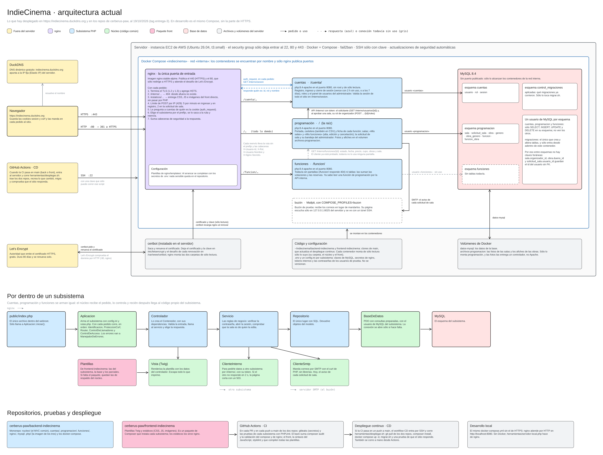
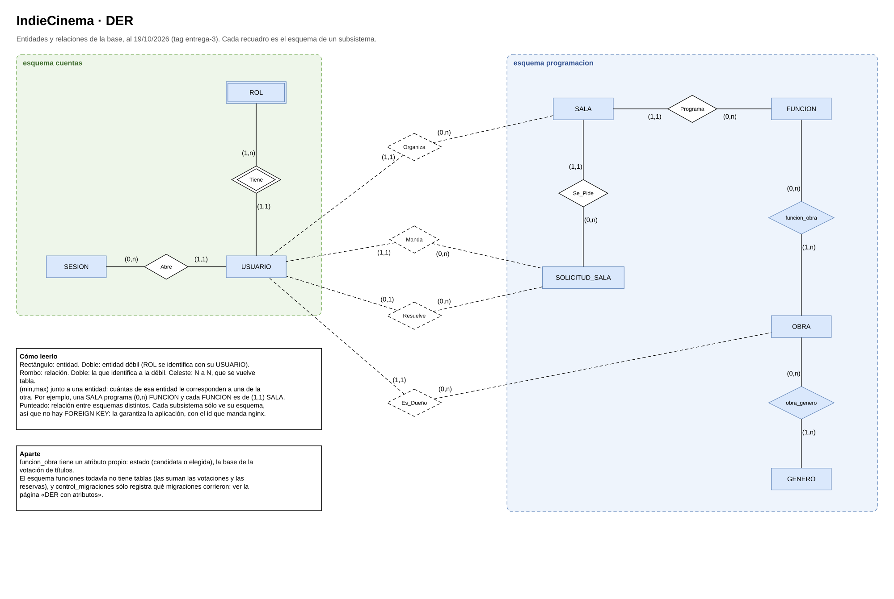
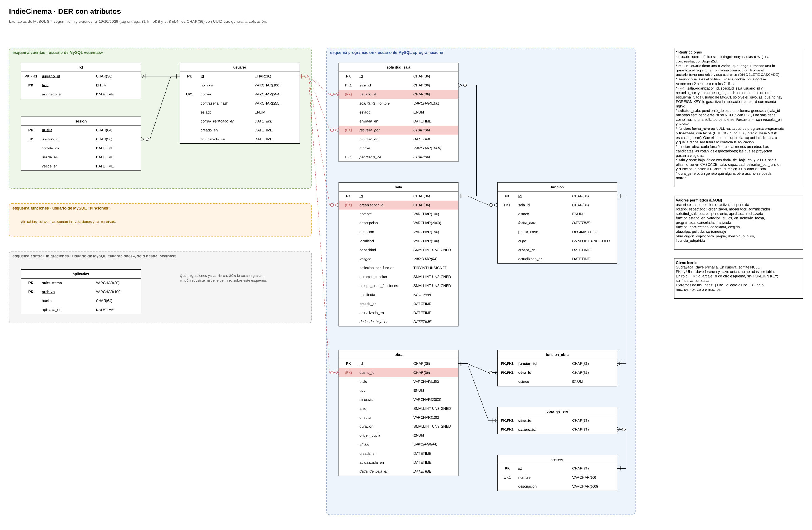

# Entrega 3 — Primer flujo completo, desplegado

Tercera de las cuatro entregas del Trabajo Práctico Integrador de **Programación en Ambiente
Web** (11086 — UNLu). Fecha de entrega: 19/10.

La entidad principal, acordada con el profesor el 5/10, es **funciones y cartelera**. El código
está en los repositorios de la organización, con el tag `entrega-3`, y el sitio está publicado:

| Qué | Dónde |
| --- | --- |
| Sitio desplegado (HTTPS) | https://indiecinema.duckdns.org |
| Back-end (núcleo, subsistemas, nginx y Docker Compose) | [cerberus-paw/backend-indiecinema](https://github.com/cerberus-paw/backend-indiecinema/tree/entrega-3) |
| Front-end (plantillas Twig, CSS y JavaScript) | [cerberus-paw/frontend-indiecinema](https://github.com/cerberus-paw/frontend-indiecinema/tree/entrega-3) |
| Cómo levantarlo | [README del back](https://github.com/cerberus-paw/backend-indiecinema/blob/entrega-3/README.md) |
| Recorrido de prueba, paso a paso y con cada rol | [`docs/guion-de-prueba.md`](https://github.com/cerberus-paw/backend-indiecinema/blob/entrega-3/docs/guion-de-prueba.md) |
| Seguridad por capa y por etapa | [`docs/seguridad.md`](https://github.com/cerberus-paw/backend-indiecinema/blob/entrega-3/docs/seguridad.md) |

Los usuarios de la demo son `administrador@indiecinema.test`, `organizador@indiecinema.test` y
`eva@indiecinema.test` (espectador). Sus contraseñas van en la entrega de Classroom, porque el
repositorio es público.

## Qué pide la entrega y dónde está

| Requisito | Cómo se cumple |
| --- | --- |
| Registro e ingreso con sesión y al menos dos roles | Subsistema `cuentas`: registro, ingreso y cierre de sesión. Roles espectador, organizador y administrador. La sesión es una cookie respaldada por una tabla y la valida nginx |
| Alta, baja, modificación y listado de la entidad principal | El organizador programa, edita y cancela funciones (baja lógica) desde su panel. El administrador gestiona salas, solicitudes y roles |
| Vista pública con búsqueda o filtro y detalle | Cartelera con filtros, paginado y descarga en CSV, y ficha de cada función |
| Desplegada con HTTPS | EC2 de AWS con Docker Compose, certificado de Let's Encrypt y despliegue continuo desde GitHub Actions |
| Seguridad aplicada | Validación en el servidor, consultas preparadas, contraseñas con Argon2id, control de rol por ruta y de dueño, CSRF y límite de intentos |
| README y tag `entrega-3` | En el back y en el front, y en este repositorio |

Las votaciones de títulos y de horario no se hicieron en esta entrega. El modelo de la base ya
prevé sus estados.

## Diagramas

La arquitectura y el modelo de la base de datos, como quedaron en esta entrega:

## Archivos

| Archivo | Descripción |
| --- | --- |
| [`diagramas/arquitectura.excalidraw`](diagramas/arquitectura.excalidraw) | Arquitectura actual, editable en [Excalidraw](https://excalidraw.com) |
| [`diagramas/der.drawio`](diagramas/der.drawio) | DER conceptual y con atributos, editable en [draw.io](https://app.diagrams.net) |
| [`diagramas/`](diagramas/) | Los mismos diagramas exportados a PNG |

## Integrantes — Grupo Cerberus

- Salvador Baez
- Mateo Nomico
- Tomás Resnik
- Agustina Ortiz
