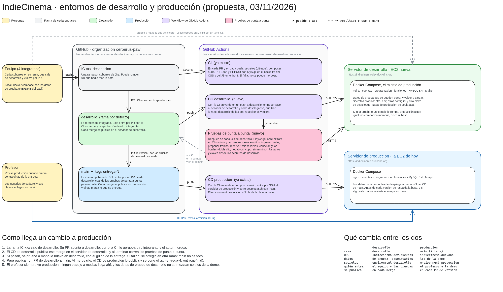

# Entrega 4 — Reservas, paneles y la versión final desplegada

Cuarta de las cuatro entregas del Trabajo Práctico Integrador de **Programación en Ambiente
Web** (11086 — UNLu). Fecha de entrega: 09/11.

La funcionalidad central es **la reserva de una función**: el espectador reserva lugares sin
superar el cupo, ve sus reservas con su comprobante y las cancela, y el organizador y el
administrador siguen cada reserva desde su panel. El código está en los repositorios de la
organización, con el tag `entrega-4`, y el sitio está publicado en la misma URL de la entrega 3:

| Qué | Dónde |
| --- | --- |
| Sitio desplegado (HTTPS) | https://indiecinema.duckdns.org |
| Back-end (núcleo, subsistemas, nginx y Docker Compose) | [cerberus-paw/backend-indiecinema](https://github.com/cerberus-paw/backend-indiecinema/tree/entrega-4) |
| Front-end (plantillas Twig, CSS y JavaScript) | [cerberus-paw/frontend-indiecinema](https://github.com/cerberus-paw/frontend-indiecinema/tree/entrega-4) |
| Cómo levantarlo | [README del back](https://github.com/cerberus-paw/backend-indiecinema/blob/entrega-4/README.md) |
| Recorrido de prueba, paso a paso y con cada rol | [`docs/guion-de-prueba.md`](https://github.com/cerberus-paw/backend-indiecinema/blob/entrega-4/docs/guion-de-prueba.md) |
| Seguridad por capa y por etapa | [`docs/seguridad.md`](https://github.com/cerberus-paw/backend-indiecinema/blob/entrega-4/docs/seguridad.md) |
| Entornos de desarrollo y producción | [`entornos.md`](entornos.md) |

Los usuarios de la demo son `administrador@indiecinema.test`, `organizador@indiecinema.test` y
`eva@indiecinema.test` (espectador). Sus contraseñas van en la entrega de Classroom, porque el
repositorio es público.

## Qué pide la entrega y dónde está

| Requisito | Cómo se cumple |
| --- | --- |
| Funcionalidad central completa | Subsistema `funciones`: reservar lugares sin superar el cupo, aunque dos personas reserven a la vez, y hasta 6 por persona. Los lugares libres se ven en la cartelera y en la ficha. «Mis reservas» con el comprobante y su código, la cancelación y el correo de la reserva confirmada |
| Interacción sin recargar, con fetch | Reservar y cancelar sin recargar, y los lugares libres que se actualizan solos. Se suman la búsqueda en vivo de la entrega 3 y el orden, el rango de precio, el paginado (tradicional o infinito) y las últimas búsquedas de la cartelera. Sin JavaScript, los formularios siguen funcionando |
| Panel de administración con estados y seguimiento | El organizador ve las reservas de sus funciones, registra la asistencia con el código y baja el listado en CSV. El administrador ve todas y anula una. Cada cambio de estado queda registrado, y cancelar una función cancela sus reservas |
| Responsive y accesible | Todo el sitio se recorre con el teclado y con el foco visible. Los campos tienen su etiqueta, el contraste llega a 4,5:1, los errores se muestran por campo y las páginas pasan el validador del W3C |
| Seguridad | Token CSRF en los formularios y en los pedidos con fetch, errores sin información interna, Content-Security-Policy, límite de pedidos por IP en la reserva y la búsqueda, y la cookie de sesión con HttpOnly, Secure y SameSite comprobada en el sitio publicado |
| Desplegada en la misma URL | La versión 0.4.0 en https://indiecinema.duckdns.org, publicada por el despliegue continuo desde `main`. Antes, cada cambio pasa por el sitio de desarrollo (ver [`entornos.md`](entornos.md)) |
| README y tag `entrega-4` | En el back y en el front, y en este repositorio |

También entran en esta entrega la votación de títulos y el acuerdo de fecha, que en la entrega 3
quedaron pendientes: el organizador abre una función a votación, los espectadores eligen la obra
y después marcan las franjas que les sirven, y al llegar al mínimo la función queda programada.

## Diagramas

Los entornos de desarrollo y producción, nuevos en esta entrega:

La arquitectura y el modelo de datos de los subsistemas de cuentas y programación siguen los de la
[entrega 3](../entrega-3/README.md#diagramas). Las tablas nuevas son las del subsistema `funciones`
(las reservas y sus cambios de estado, y el acuerdo de fecha con sus franjas y sus votos) y la de
los votos de la votación de títulos, en `programacion`. Cada una está en las migraciones de su
subsistema: [`funciones`](https://github.com/cerberus-paw/backend-indiecinema/tree/entrega-4/funciones/migraciones)
y [`programacion`](https://github.com/cerberus-paw/backend-indiecinema/tree/entrega-4/programacion/migraciones).

## Archivos

| Archivo | Descripción |
| --- | --- |
| [`entornos.md`](entornos.md) | Los dos entornos y cómo llega un cambio a producción |
| [`diagramas/entornos.excalidraw`](diagramas/entornos.excalidraw) | El diagrama de entornos, editable en [Excalidraw](https://excalidraw.com) |
| [`diagramas/entornos.png`](diagramas/entornos.png) | El mismo diagrama exportado a PNG |

## Integrantes — Grupo Cerberus

- Salvador Baez
- Mateo Nomico
- Tomás Resnik
- Agustina Ortiz
