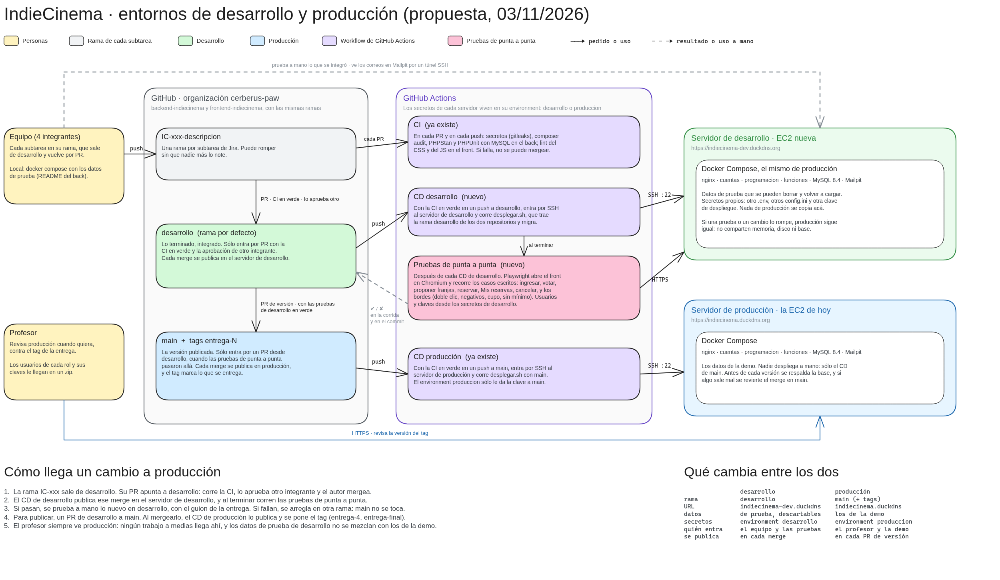

# Entornos de desarrollo y producción

Propuesta del 03/11/2026, a pedido del profesor en la clase del 02/11. El profesor revisa la versión
entregada en cualquier momento, así que el equipo sigue trabajando en otro lado y sólo publica lo
que ya probó.

## Los dos entornos

| | Desarrollo | Producción |
| --- | --- | --- |
| URL | https://indiecinema-dev.duckdns.org | https://indiecinema.duckdns.org |
| Rama | `desarrollo` (la rama por defecto) | `main` y los tags `entrega-N` |
| Servidor | Otra EC2 de AWS | La EC2 de la E3 |
| Datos | De prueba, se pueden borrar y volver a cargar | Los de la demo |
| Secretos | Environment `desarrollo` de GitHub y su `.env` | Environment `produccion` y su `.env` |
| Lo usan | El equipo y las pruebas de punta a punta | El profesor y la demo |

Los dos corren el mismo Docker Compose: nginx, cuentas, programación, funciones, MySQL 8.4 y
Mailpit. Desarrollo va en otra instancia y no en la misma. Así una prueba o un cambio que lo tire
no le quita memoria a producción (la t3.small tiene 2 GB) ni toca la base que revisa el profesor.

## Cómo llega un cambio a producción

1. Cada subtarea de Jira tiene su rama `IC-xxx-descripcion`, que sale de `desarrollo`. Su PR
   apunta a `desarrollo`, que es la rama por defecto de los dos repositorios: corre la CI (gitleaks, composer audit, PHPStan y PHPUnit en el back,
   y el lint en el front), lo aprueba otro integrante y lo mergea el autor.
2. Con la CI en verde, el CD de desarrollo entra por SSH al servidor de desarrollo y corre
   `herramientas/desplegar.sh`. El script trae la rama `desarrollo` de los dos repositorios,
   recrea los contenedores y migra la base.
3. Al terminar el despliegue, las pruebas de punta a punta (Playwright) abren el front de
   desarrollo en Chromium y recorren los casos escritos. La corrida queda en verde o en rojo en
   Actions, y si fallan deja las capturas de lo que falló. Los usuarios y las claves salen de los
   secretos del environment `desarrollo`, no del código. El back y el front usan cuentas y
   funciones distintas, para no pisarse cuando un cambio toca los dos y despliegan a la vez.
4. Para publicar se abre un PR de `desarrollo` a `main`, con las pruebas en verde y lo nuevo
   probado a mano en desarrollo. Al mergearlo, el CD de producción lo publica y se pone el tag.
5. Si algo sale mal en producción, se revierte el merge en `main` y el CD vuelve a publicar la
   versión anterior. Antes de cada versión se respalda la base de producción.

## Los casos de prueba

Primero se escriben los casos, y después se automatizan. Cada uno lleva el camino feliz y sus
bordes:
- apretar dos veces el mismo botón;
- valores negativos, con letras o por encima del cupo;
- cerrar una votación o un acuerdo sin llegar al mínimo.

Los casos están en `e2e/casos.md` del front. Hoy cubren ingresar, reservar (con doble clic, 0, -1,
letras y por encima de los lugares libres), «Mis reservas» y cancelar. Después siguen votar títulos,
proponer y votar franjas, confirmar la franja ganadora y el panel de reservas del organizador.

## Lo que recibe el profesor

Un zip con las dos URL, los usuarios de cada rol con sus claves y los enlaces a los repositorios.
Las claves no van en este repositorio, porque es público.
