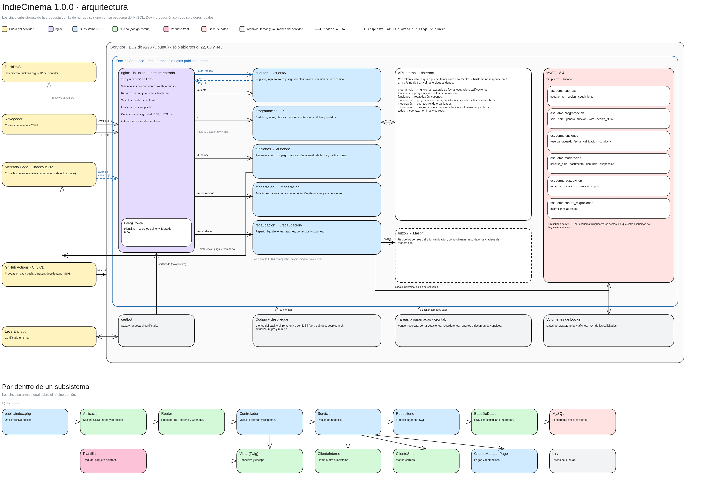
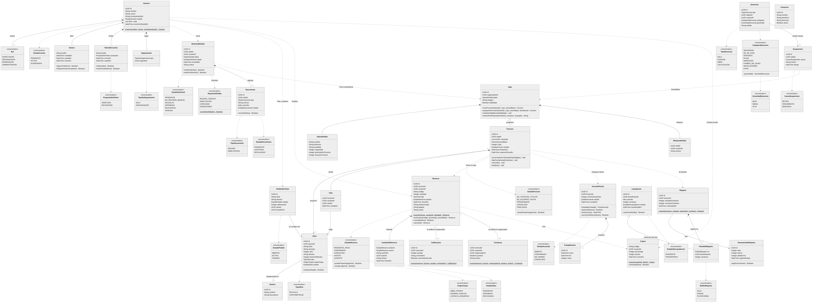

# Entrega final — IndieCinema 1.0.0

Cierre del Trabajo Práctico Integrador de **Programación en Ambiente Web** (11086 — UNLu).
El alcance es el de la [propuesta de la entrega 1](../entrega-1/): los cinco subsistemas
funcionando y publicados. El código está en los repositorios de la organización, con el tag
`entrega-final` (versión 1.0.0):

| Qué | Dónde |
| --- | --- |
| Sitio desplegado (HTTPS) | https://indiecinema.duckdns.org |
| Back-end (núcleo, subsistemas, nginx y Docker Compose) | [cerberus-paw/backend-indiecinema](https://github.com/cerberus-paw/backend-indiecinema/tree/entrega-final) |
| Front-end (plantillas Twig, CSS y JavaScript) | [cerberus-paw/frontend-indiecinema](https://github.com/cerberus-paw/frontend-indiecinema/tree/entrega-final) |
| Cómo levantarlo | [README del back](https://github.com/cerberus-paw/backend-indiecinema/blob/entrega-final/README.md) |
| Recorrido de prueba con cada rol | [`docs/guion-de-prueba.md`](https://github.com/cerberus-paw/backend-indiecinema/blob/entrega-final/docs/guion-de-prueba.md) |
| Permisos por rol | [`docs/permisos.md`](https://github.com/cerberus-paw/backend-indiecinema/blob/entrega-final/docs/permisos.md) |
| Seguridad por capa | [`docs/seguridad.md`](https://github.com/cerberus-paw/backend-indiecinema/blob/entrega-final/docs/seguridad.md) |
| Entornos de desarrollo y producción | [`entornos.md`](../entrega-4/entornos.md) de la entrega 4 |

Las contraseñas de los usuarios de la demo van en la entrega de Classroom, porque el repositorio
es público.

## Los cinco subsistemas

| Subsistema | Qué hace |
| --- | --- |
| `cuentas` | Registro, ingreso, roles y la administración de usuarios, con la suspensión de cuentas |
| `programacion` | Obras, salas, funciones, cartelera, votación de títulos y pedidos de títulos |
| `funciones` | Reservas con cupo, pago, cancelación hasta 24 h antes, acuerdo de fecha y calificaciones |
| `moderacion` | Solicitudes de sala con su documentación y las denuncias, con gravedad y bajas de la cartelera |
| `recaudacion` | Reparto de lo cobrado, liquidaciones, beneficios por buena conducta y reportes que terminan en una sugerencia |

Lo nuevo respecto de la entrega 4 son `moderacion` y `recaudacion`, y lo que ellos agregan a los
otros tres.

## Diagramas

La arquitectura y el modelo de objetos de la versión 1.0.0, con los cinco subsistemas:

| Archivo | Qué es |
| --- | --- |
| [`diagramas/arquitectura.excalidraw`](diagramas/arquitectura.excalidraw) | Arquitectura, editable en [Excalidraw](https://excalidraw.com) |
| [`diagramas/modelo-de-objetos.mmd`](diagramas/modelo-de-objetos.mmd) | Modelo de objetos en [Mermaid](https://mermaid.live): el de la [entrega 2](../entrega-2/) puesto al día con las clases del código |

## Integrantes — Grupo Cerberus

- Salvador Baez
- Mateo Nomico
- Tomás Resnik
- Agustina Ortiz
